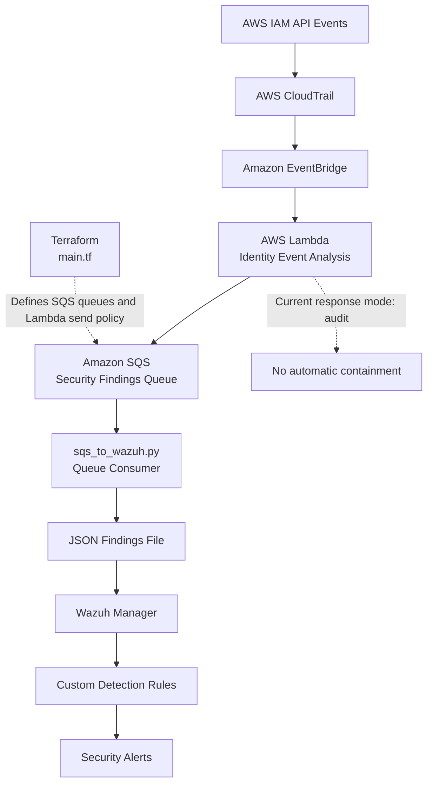

# AWS Cross-Account Identity Self-Healing Engine

A security automation lab combining AWS IAM event monitoring, EventBridge, Lambda, SQS, Terraform, and Wazuh to detect suspicious identity activity and generate security findings.

## Project Goals

- Monitor selected AWS IAM security events.
- Classify identity events and flag findings that require review.
- Process events through AWS Lambda and publish findings to SQS.
- Forward queued findings to a local JSON file monitored by Wazuh.
- Generate Wazuh alerts using custom detection rules.
- Keep response behavior in audit mode during development and verification.

## Architecture



**Event flow**

1. AWS IAM API activity is recorded through CloudTrail and matched by an EventBridge rule.
2. AWS Lambda classifies selected identity events and creates security findings.
3. Findings are published to Amazon SQS.
4. `sqs_to_wazuh.py` consumes messages and writes findings to the local JSON file.
5. Wazuh monitors the file and evaluates findings against custom detection rules.
6. Matching findings generate Wazuh security alerts.
7. Terraform manages the infrastructure defined in `main.tf`.

**Response safety:** Lambda remains in audit mode. The current verification does not establish that live containment works end to end.

## Key Files

| File | Purpose |
|---|---|
| `main.tf` | Terraform infrastructure definition |
| `detect_identity_events.py` | Identity-event detection and classification |
| `inspect_cloudtrail.py` | CloudTrail event inspection |
| `sqs_to_wazuh.py` | SQS-to-Wazuh findings bridge |
| `lambda/deployed/lambda_function.py` | Lambda handler source |
| `lambda/package/lambda_function.py` | Lambda package source |
| `lambda/test_containment.py` | Containment-safety unit tests |
| `.gitignore` | Excludes local state, credentials, generated output, and backups |

## Validation Completed

- Wazuh generated an alert from a synthetic JSON finding.
- The SQS consumer was running and its logs showed processed `TagUser` findings.
- Nine containment-safety unit tests passed.
- The deployed Lambda was configured with `ALERT_MODE=audit` at the last verification.
- EventBridge's monitoring metrics showed one invocation at `2026-10-24 14:05 UTC`, correlated with Lambda logs at `14:06:48 UTC` showing a `TagUser` event processed and successfully sent to SQS.

These checks validate key components, but do not prove that every event path or live containment action has been tested end to end.

## Safety

- Keep Lambda in audit mode during development.
- Never commit AWS credentials, Terraform state, private keys, runtime findings, or generated deployment archives.
- Treat access-key deactivation as a potentially disruptive action requiring explicit approval and controlled testing.

## Prerequisites and Setup

**Prerequisites**
- AWS CLI configured with appropriate permissions for the lab.
- Terraform installed.
- Python environment with the dependencies required by the project.
- A running Wazuh manager configured to monitor the findings JSON file and load the project's custom detection rules.

**Setup notes**
- Review `main.tf` and your AWS account and region configuration before running Terraform.
- Run `terraform plan` and review the proposed changes before considering `terraform apply`; AWS resources may incur charges.
- Configure the Lambda, SQS consumer, and Wazuh integration according to the project's existing configuration.
- Keep Lambda in audit mode. Do not test live containment without explicit approval and a controlled test environment.

The test command below validates the local unit tests; it does not deploy or configure the full AWS/Wazuh pipeline.

## Run Tests

From the project root:

```bash
python -m unittest discover -s lambda -p 'test_*.py' -v
```

## Verification Evidence

The following checks were completed during development:

- Lambda configuration reported `Active` and `LastUpdateStatus: Successful`.
- Lambda was configured with `ALERT_MODE=audit`.
- A synthetic `TagUser` event was invoked directly against Lambda.
- Lambda classified the event as medium severity and reported that the finding was sent to SQS.
- The SQS consumer wrote the finding to the Wazuh input JSON file.
- Wazuh generated a level 10 alert under custom rule `100920` for the synthetic finding.
- Nine containment-safety unit tests passed.
- The repository excludes Terraform state, runtime findings, logs, and deployment ZIP archives.

## Evidence Artifacts

Sanitized validation summaries are available in the [`evidence/`](evidence/) directory:

- [Containment-safety unit tests](evidence/containment-tests.txt) — results from nine unit tests covering audit mode, event validation, target-account checks, and mocked containment behavior.
- [AWS event processing](evidence/aws-event-processing.txt) — CloudWatch log evidence of IAM event classification and successful SQS publishing.
- [Wazuh alert validation](evidence/wazuh-alert-validation.txt) — synthetic findings matching custom rule `100920` at alert level 10.

These artifacts summarize observed results without including raw CloudWatch logs or full Wazuh alert records. The tests use mocked AWS calls, and live containment remains unverified.

## Known Limitations

- Automatic EventBridge-triggered processing is supported by correlated EventBridge invocation metrics and Lambda execution logs. A unique event ID was not available to prove a one-to-one match between the metric and log entry.
- The deployed Lambda hardcodes `TEST_USER` to `self-healing-test-user`; the local source allows configuration through an environment variable. Review and reconcile this difference before any future deployment.
- Live containment was not tested as part of the final pipeline verification. The deployed Lambda should remain in audit mode until controlled containment testing is explicitly approved.
