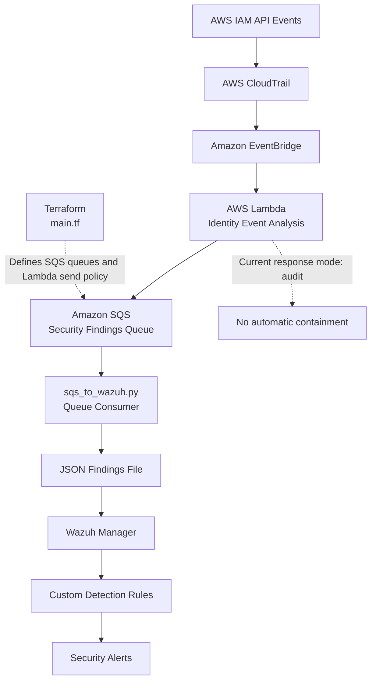

# AWS Cross-Account Identity Self-Healing Engine

A security automation lab combining AWS IAM event monitoring, EventBridge, Lambda, SQS, Terraform, and Wazuh to detect suspicious identity activity and generate security findings.

## Project Goals

- Monitor selected AWS IAM security events.
- Classify identity events and flag findings that require review.
- Process events through AWS Lambda and publish findings to SQS.
- Forward queued findings to a local JSON file monitored by Wazuh.
- Generate Wazuh alerts using custom detection rules.
- Keep response behavior in audit mode during development and verification.

## Architecture



**Event flow**

1. AWS IAM API activity is recorded through CloudTrail and matched by an EventBridge rule.
2. AWS Lambda classifies selected identity events and creates security findings.
3. Findings are published to Amazon SQS.
4. `sqs_to_wazuh.py` consumes messages and writes findings to the local JSON file.
5. Wazuh monitors the file and evaluates findings against custom detection rules.
6. Matching findings generate Wazuh security alerts.
7. Terraform manages the infrastructure defined in `main.tf`.

**Response safety:** Lambda remains in audit mode. The current verification does not establish that live containment works end to end.

## Key Files

| File | Purpose |
|---|---|
| `main.tf` | Terraform infrastructure definition |
| `detect_identity_events.py` | Identity-event detection and classification |
| `inspect_cloudtrail.py` | CloudTrail event inspection |
| `sqs_to_wazuh.py` | SQS-to-Wazuh findings bridge |
| `lambda/deployed/lambda_function.py` | Lambda handler source |
| `lambda/package/lambda_function.py` | Lambda package source |
| `lambda/test_containment.py` | Containment-safety unit tests |
| `.gitignore` | Excludes local state, credentials, generated output, and backups |

## Validation Completed

- Lambda configuration in `us-east-1` reported `Active` and `LastUpdateStatus: Successful`.
- Lambda was configured with `ALERT_MODE=audit`.
- The EventBridge rule `identity-self-healing-iam-security-events` was enabled and its target was the expected Lambda function.
- Both SQS queues were accessible by queue URL, and their key attributes were inspected.
- The local SQS consumer process was running. Its log showed five `TagUser` findings logged in the inspected output.
- The latest five records in `wazuh-logs/identity-findings.json` parsed as JSON and showed `response_mode=audit` and `action_taken=none`.
- Wazuh custom rule `100920` generated level-10 alerts for a synthetic `WAZUH_PIPELINE_TEST` record and a `TagUser` record explicitly attributed to `synthetic-pipeline-test`.
- Nine containment-safety unit tests passed in the previously recorded test run.
- A Gitleaks scan using the documented temporary baseline reported no additional findings beyond that baseline.

These checks validate individual components and synthetic detection behavior. They do not establish a uniquely correlated real AWS event from CloudTrail through Wazuh, or prove live containment works end to end.

## Safety

- Keep Lambda in audit mode during development.
- Never commit AWS credentials, Terraform state, private keys, runtime findings, or generated deployment archives.
- Treat access-key deactivation as a potentially disruptive action requiring explicit approval and controlled testing.

## Secret-Scanning Review

- Gitleaks scanned the local Git history and reported three findings matching the `aws-access-token` rule in `lambda/test_containment.py`, at lines 36, 150, and 174 of commit `83efdca845d74a4efa267d35c41511afcadf3d9b`.
- The flagged values were reviewed and appear to be dummy access-key identifiers used in mocked unit-test fixtures. This is a code-based assessment, not independent proof that the values have never been valid credentials.
- A temporary Gitleaks baseline was used to suppress these previously identified findings. The baseline report is stored outside the repository under `/tmp` and is not a project artifact.
- A clean scan using that baseline means no findings beyond the baseline were reported; it does not mean the historical findings were removed or that the repository is free of all secrets.
- Do not publish credentials or raw scan reports. If any value is suspected to be a real credential, verify its status and follow the relevant AWS credential-rotation and incident-response procedures.
- Re-run secret scanning before publishing, and review any new findings rather than automatically adding them to the baseline.

## Prerequisites and Setup

**Prerequisites**
- AWS CLI configured with appropriate permissions for the lab.
- Terraform installed.
- Python environment with the dependencies required by the project.
- A running Wazuh manager configured to monitor the findings JSON file and load the project's custom detection rules.

**Setup notes**
- Review `main.tf` and your AWS account and region configuration before running Terraform.
- Run `terraform plan` and review the proposed changes before considering `terraform apply`; AWS resources may incur charges.
- Configure the Lambda, SQS consumer, and Wazuh integration according to the project's existing configuration.
- Keep Lambda in audit mode. Do not test live containment without explicit approval and a controlled test environment.

The test command below validates the local unit tests; it does not deploy or configure the full AWS/Wazuh pipeline.

## Run Tests

From the project root:

```bash
python -m unittest discover -s lambda -p 'test_*.py' -v
```

## Verification Evidence

The following evidence was observed during development:

- Lambda in `us-east-1` reported `Active`, `LastUpdateStatus: Successful`, and `ALERT_MODE=audit`.
- EventBridge was enabled and configured to target the Lambda function.
- SQS queue URLs and queue attributes were retrieved successfully.
- The local SQS consumer was running and its inspected log showed `TagUser` findings being logged.
- Recent finding records parsed as JSON and retained `response_mode=audit` and `action_taken=none`.
- Wazuh rule `100920` generated level-10 alerts for two inspected synthetic/test findings: `WAZUH_PIPELINE_TEST` and a `TagUser` record attributed to `synthetic-pipeline-test`.
- Nine containment-safety unit tests passed in the previously recorded test run.
- Earlier development evidence recorded a `TagUser` event classified by Lambda and reported as successfully sent to SQS. EventBridge invocation metrics and Lambda logs were correlated by time, but no unique event ID established a one-to-one match.

The inspected Wazuh alerts are synthetic/test evidence, not proof of a real AWS event traversing the entire pipeline. The current CLI identity cannot call `logs:GetLogEvents`, so the latest Lambda log contents could not be independently inspected during this verification.

## Evidence Artifacts

Sanitized validation summaries are available in the [`evidence/`](evidence/) directory:

- [Containment-safety unit tests](evidence/containment-tests.txt) — results from nine unit tests covering audit mode, event validation, target-account checks, and mocked containment behavior.
- [AWS event processing](evidence/aws-event-processing.txt) — CloudWatch log evidence of IAM event classification and successful SQS publishing.
- [Wazuh alert validation](evidence/wazuh-alert-validation.txt) — synthetic findings matching custom rule `100920` at alert level 10.

These artifacts summarize observed results without including raw CloudWatch logs or full Wazuh alert records. The tests use mocked AWS calls, and live containment remains unverified.

## Known Limitations

- Earlier EventBridge invocation metrics and Lambda execution logs were correlated by time, but a unique event ID was not available to prove a one-to-one match.
- A real AWS event has not yet been reliably correlated across CloudTrail/EventBridge, Lambda, SQS, the local consumer, and Wazuh.
- The current `terraform-lab` identity lacks `logs:GetLogEvents` for the Lambda log group, preventing independent inspection of recent Lambda log contents.
- The AWS CLI default region is `ap-south-1`, while the Lambda, EventBridge rule, and SQS resources verified for this workflow are in `us-east-1`. Specify the intended region explicitly when running verification commands.
- The deployed Lambda hardcodes `TEST_USER` to `self-healing-test-user`; the local source allows configuration through an environment variable. Review and reconcile this difference before any future deployment.
- The SQS consumer writes finding records and processed-message state separately. A crash between these operations may result in duplicate output.
- Live containment has not been verified end to end. Keep the deployed Lambda in audit mode until controlled containment testing is explicitly approved.
